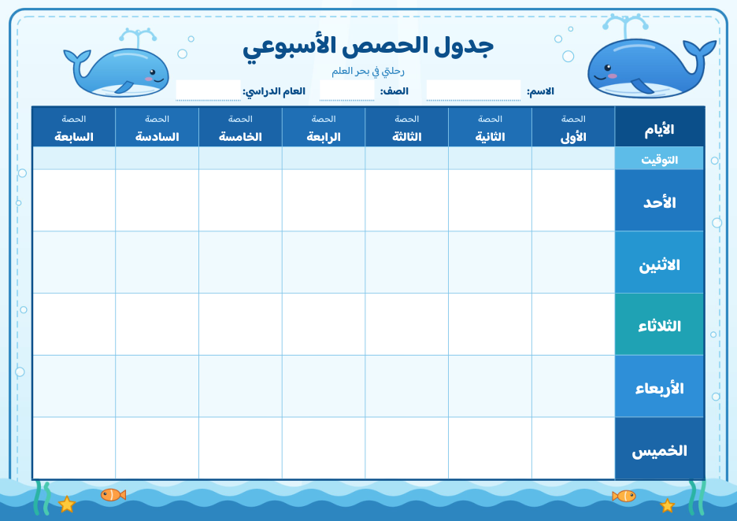

# جدول الحصص الأسبوعي — ثيم الحوت 🐋

جدول حصص أسبوعي قابل للكتابة في برنامج Microsoft Word، بتصميم بحري لطيف (حيتان، فقاعات، أمواج).

## المواصفات

- **الأيام:** الأحد، الاثنين، الثلاثاء، الأربعاء، الخميس (دون الجمعة والسبت)
- **الحصص:** سبع حصص، من الأولى إلى السابعة
- **صف للتوقيت** لكتابة وقت كل حصة
- **خانات** للاسم والصف والعام الدراسي
- **الصفحة:** A4 أفقية، صفحة واحدة جاهزة للطباعة
- **الخط:** Baloo Bhaijaan 2 (مضمَّن داخل الملف، فلا يلزم تثبيته)

## طريقة الاستخدام

1. افتح الملف `جدول-الحصص-الحوت.docx` في Word.
2. اضغط داخل أي خانة واكتب اسم المادة، فيظهر النص بنفس الخط والتنسيق.
3. الخلفية مثبّتة في رأس الصفحة، فلا تتحرك أثناء الكتابة. لتعديلها انقر نقرًا مزدوجًا أعلى الصفحة.
